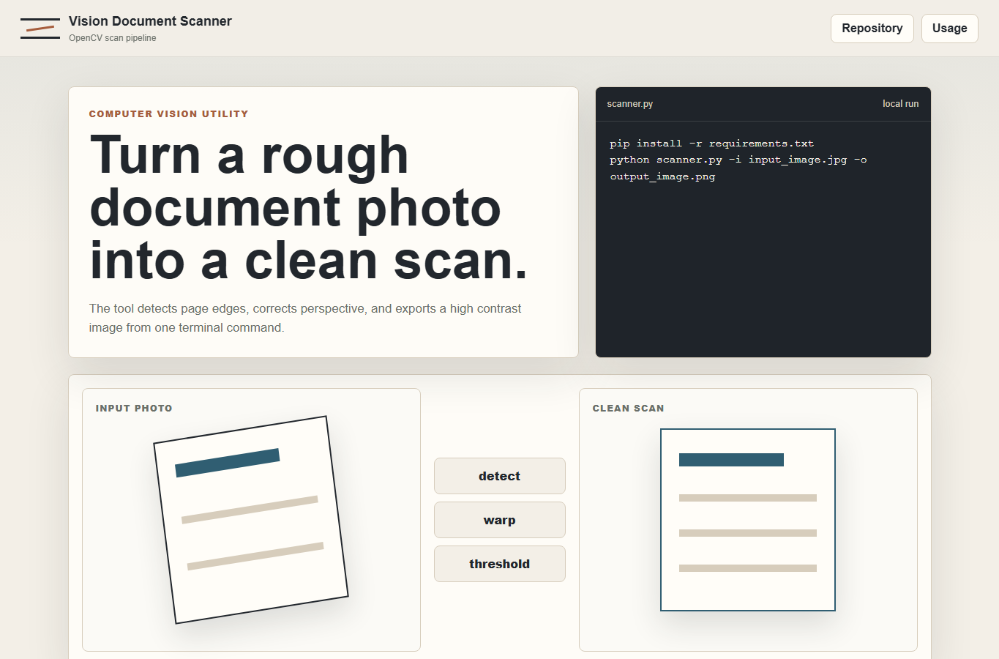

<p align="center">
  
</p>

<p align="center">
  
  
  
  
</p>

---

# Vision Document Scanner

Vision Document Scanner is a small computer vision utility that turns a photo of a document into a clean scanned image. It detects the document edges, corrects perspective, converts the result to grayscale, and applies adaptive thresholding for a high contrast output.



## What It Does

- Detects the largest document-like contour in a photo.
- Applies a four-point perspective transform.
- Produces a clean black and white scan.
- Works from the terminal with one command.
- Uses only Python, OpenCV, and NumPy.

## Requirements

```bash
pip install -r requirements.txt
```

## Usage

```bash
python scanner.py -i input_image.jpg -o output_image.png
```

## Example Workflow

1. Take a photo of a document on a contrasting background.
2. Run the scanner with the image path.
3. Open the generated PNG.
4. If the document is not detected, try a photo with clearer edges and less blur.

## Project Goal

The project is intentionally simple: one useful command that demonstrates document detection, perspective correction, and scan-style image processing.
